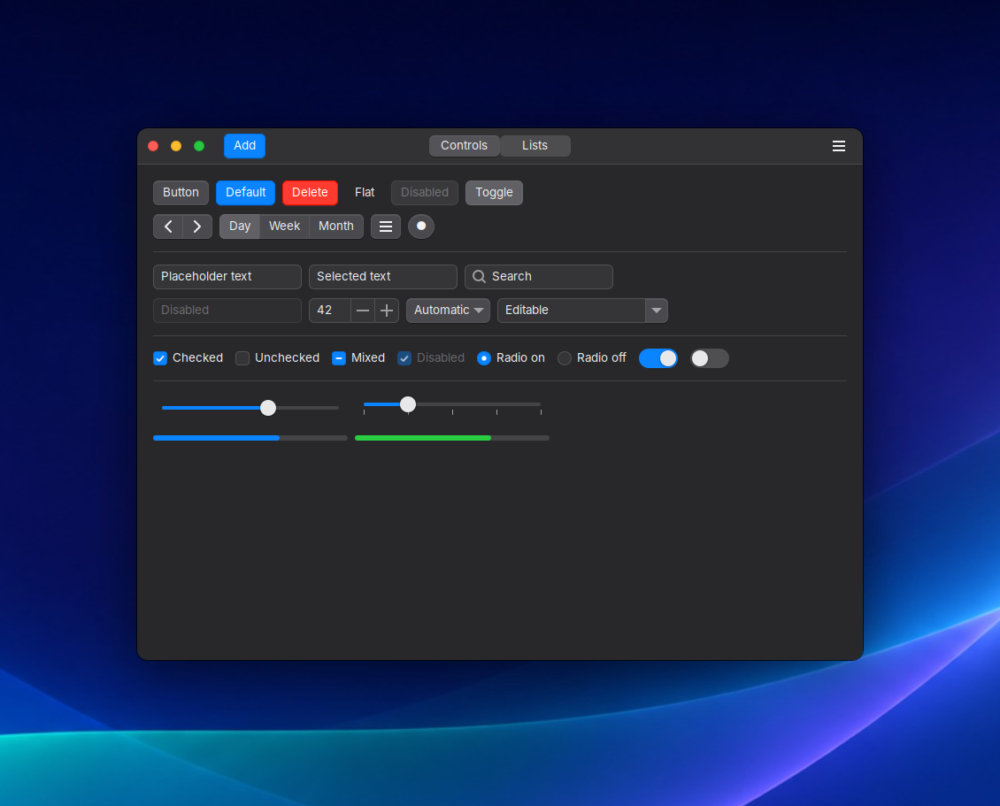
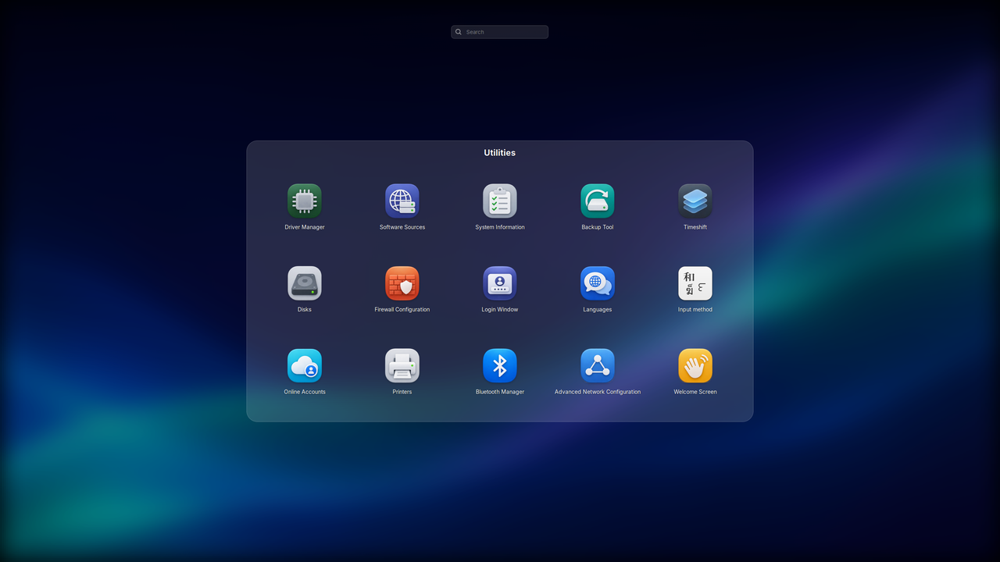

# NalaMint

A rounded, macOS-inspired theme for Linux Mint Cinnamon (built and tested on
Mint 22.3, Cinnamon 6.6.9, X11). Original code and artwork; no Apple assets.

Two variants: **NalaMint** (light) and **NalaMint-Dark**.




## Install

**Package (everything):** download `nalamint_<version>_all.deb` from the
[releases page](https://github.com/AlanGreyjoy/NalaMint/releases), then

```bash
sudo apt install ./nalamint_1.0.0_all.deb
```

It installs the themes, icon theme and wallpapers system-wide, plus the
applets, extensions and `nalamint-layout`. Then:

1. System Settings → Themes: *NalaMint* or *NalaMint-Dark* for Applications
   and Desktop, *NalaMint* for Icons.
2. System Settings → Windows: title bar buttons on the left, for the Mac order.
3. `nalamint-layout dock` for the menu bar + dock layout with the logo menu
   and Launchpad (`nalamint-layout restore` puts your layout back).

To remove: `nalamint-layout restore`, then `sudo apt remove nalamint`.

**Cinnamon Spices:** the two themes (GTK + desktop), the three applets
(Launchpad, System Menu, App Name) and the two extensions (Rounded Corners,
Menu Bar) are also packaged for the Spices site (`tools/spices.py`), which
System Settings downloads from: Themes → Add/Remove, Applets → Download,
Extensions → Download. They are not submitted there yet. Spices can't carry
icon themes or wallpapers.

**From source:** see *Build and apply* below.

## What it covers

| Part | Source | Notes |
| --- | --- | --- |
| GTK3 apps | `src/gtk-3.0/` | Buttons, fields, switches, menus, lists, sidebars, Nemo/Xed tweaks |
| GTK4 / libadwaita apps | `src/libadwaita/` | Colors from the palette + traffic-light window buttons, on top of libadwaita's own stylesheet |
| Window frames | `src/gtk-3.0/widgets/_windows.scss` | Muffin 6.6 draws frames from the GTK theme's CSS (the old `metacity-1` format is ignored) |
| Desktop | `src/cinnamon/cinnamon.scss` | Panel, start menu, applet menus, calendar, notifications, OSDs, Alt-Tab |
| Rounded corners | `src/extension/nalamint-corners@nalamint/` | Cinnamon extension: rounds all four corners of every normal window |
| Menu bar | `src/extension/nalamint-menubar@nalamint/` | Cinnamon extension: blurs the wallpaper behind panels, dark panel text on bright wallpaper, draws the dock bar |
| App name | `src/applet/nalamint-appname@nalamint/` | Applet: focused app's name in bold in the menu bar, with Show All Windows / Hide / Quit |
| Launchpad | `src/applet/nalamint-launchpad@nalamint/` | Applet: full-screen, centered app grid over the blurred wallpaper (dock icon or Super), with search and pages |
| Logo menu | `src/applet/nalamint-system@nalamint/` | Applet: Mac-style menu at the top left: About, System Settings, Software Manager, Force Quit, Sleep, Restart, Shut Down, Lock Screen, Log Out |
| Icons | `src/icons/` | Codex-generated icon theme: folders with symbols, trash, Mint app and System Settings icons; inherits the rest from Mint-L |
| Qt5 apps | `tools/qt.py` + `build.py` (`build/qt/*.conf`) | qt5ct config: Fusion style with the NalaMint palette, icons, Inter, GTK dialogs |
| Flatpak apps | `tools/flatpak.py` | Read-only theme/icon access for GTK3 Flatpaks; per-app libadwaita colors + traffic lights |
| Wallpapers | `src/wallpapers/` + `tools/wallpaper.py` | Generated light and dark wallpapers, listed in System Settings → Backgrounds |
| Layout | `tools/layout.py` | Menu bar + dock layout (`dock`), or back to yours (`restore`) |
| Colors | `src/palette.toml` | One file drives every part |

## Build and apply

Needs `sassc` (`sudo apt install sassc`). Inter is the intended UI font (`fonts-inter`).

```bash
./build.py --install        # build both variants into ~/.themes, extension into ~/.local/share/cinnamon/extensions
tools/apply.sh dark         # or: tools/apply.sh light
tools/revert.sh             # put your previous themes back
```

`apply.sh` also moves the window buttons to the left (`close,minimize,maximize:`)
and enables both extensions. Their settings (corner radius and shadow, blur
strength, the brightness that switches panel text dark) are in System Settings →
Extensions.

## GTK4 and libadwaita apps

Mint's libadwaita (1.5, patched) reads `<theme>/libadwaita-1.5/base.css` and
`defaults-light.css` / `defaults-dark.css` from the current GTK theme. `build.py`:

- extracts libadwaita's own stylesheet from the installed library
  (`gresource extract … /org/gnome/Adwaita/styles/base.css`; LGPL-2.1+, not
  stored in this repo) and appends `src/libadwaita/overrides.scss`
  (traffic-light window buttons, bold titles);
- compiles `src/libadwaita/defaults.scss` into the 47 named colors for each
  variant from the palette;
- writes the same stylesheet to `gtk-4.0/` for plain GTK4 apps (`gtk.css` =
  this variant, `gtk-dark.css` = dark).

libadwaita apps choose light or dark from `org.x.apps.portal color-scheme`;
`apply.sh` sets it to match the variant. Tested with Calculator (dark) and
System Monitor (light, via `ADW_DEBUG_COLOR_SCHEME=prefer-light`). Flatpak apps
use their own runtime's libadwaita and are not affected.

## Icons and font

`build.py` assembles the **NalaMint** icon theme into `~/.local/share/icons/NalaMint`.
Every icon is a generated image (Codex CLI), not hand-drawn:

- **folders and trash** (`src/icons/places/`): a plain folder, 11 special
  folders with a symbol pressed into the front (Documents, Downloads, Music,
  Pictures, Videos, Templates, Public, Desktop, Home, Network, Saved search),
  and empty/full trash;
- **app icons** (`src/icons/apps/`), 28 in two sheets: Files, System Settings,
  Software Manager, Update Manager, Terminal, Text Editor, Calculator, System
  Monitor; Document Viewer, Image Viewer, Media Player, Archive Manager, Backup
  Tool, Timeshift, Driver Manager, Software Sources, System Information,
  Warpinator, Notes, Screenshot, Disks, Disk Usage, Calendar, Web Apps,
  Printers, Passwords and Keys, Document Scanner, File Renamer. Apps whose icon
  is their own logo (Firefox, Thunderbird, LibreOffice…) keep it;
- **System Settings icons** (`src/icons/apps/cs-*.png` and a few more), 40 in
  two sheets: every page in the Appearance, Preferences, Hardware and
  Administration sections; Nvidia Settings keeps its logo;
- **sheet 3** (16): the section headers in System Settings, Fingerprints,
  System Administration, Advanced Network Configuration, Character Map, Power
  Statistics, on-screen keyboards, USB Image Writer, Welcome Screen, Library,
  Pix, Hypnotix and Qt5 Settings; plus the Launchpad dock icon.

Each set was generated as one transparent grid sheet (`*-sheet-v1.png`), cut
into 512 px PNGs by `tools/slice_sheet.py`, and is scaled to 16–256 px at build
time and mapped to icon names in `ICONS` (`build.py`). Prompts and Codex source
paths are in each folder's `PROMPTS.md`. Everything else is inherited from
`Mint-L,Mint-Y,Adwaita,hicolor`.

`apply.sh` sets the icon theme and the **Inter** font (`fonts-inter`; interface,
documents, window titles in bold, desktop icons). `tools/icon_sheet.py out.png`
renders all icons to one image for review.

## Qt apps

Qt5's built-in GTK3 integration (picked automatically on Cinnamon) passes on
fonts, icons and file dialogs but not colors, so Qt5 apps stay light. With
`qt5ct` installed (`sudo apt install qt5ct`), `tools/qt.py apply dark|light`
(also run by `apply.sh`):

- installs color schemes generated from the palette (`build/qt/*.conf`) and
  writes `~/.config/qt5ct/qt5ct.conf` (Fusion, NalaMint icons, Inter, GTK3
  dialogs, macOS button order), backing up any existing file;
- sets `QT_QPA_PLATFORMTHEME=qt5ct` in `~/.xsessionrc` (between NalaMint
  markers) and in the running Cinnamon/D-Bus environment, so apps started from
  now on pick it up.

`tools/qt.py revert` (also run by `revert.sh`) undoes all of it. Qt6 apps can't
load qt5ct and keep Qt's GTK3 integration.

## Wallpapers

Two original wallpapers, light and dark, generated with the Codex CLI (prompts
and sources in `src/wallpapers/PROMPTS.md`). `build.py` scales the newest
`nalamint-<variant>-vN.png` to 2560×1440 JPEG and `--install` copies them to
`~/.local/share/backgrounds/nalamint/`. `apply.sh` adds that folder to
System Settings → Backgrounds (`~/.config/cinnamon/backgrounds/user-folders.lst`)
but doesn't change your wallpaper; `tools/wallpaper.py set dark|light` does.
`revert.sh` removes the folder from the list and restores the wallpaper that
was set before the first `apply.sh`.

## Flatpak apps

`tools/flatpak.py apply` (also run by `apply.sh`; no root needed):

- GTK3 Flatpaks (Lutris, GIMP) already get the theme *name* from the settings
  portal; a user-level override (`flatpak override --user
  --filesystem=~/.themes:ro --filesystem=xdg-data/icons:ro`) lets them load it.
- libadwaita Flatpaks (Bottles, ProtonPlus) run the runtime's newer libadwaita,
  which ignores themes but still builds its colors from named colors. Each
  GNOME-runtime app gets `build/flatpak/gtk-4.0/gtk.css` (light colors, dark
  ones under `@media (prefers-color-scheme: dark)`, traffic lights) in its own
  `~/.var/app/<id>/config/gtk-4.0/`, so host apps are untouched.

`tools/flatpak.py revert` restores whatever was there (backups in
`build/flatpak-backup/`). Tested with ProtonPlus and Lutris. Mint-L icons live
in `/usr/share/icons`, which Flatpaks can't see, so non-folder icons there come
from the runtime.

## Dock layout

```bash
tools/layout.py dock        # bottom dock with Launchpad, logo menu, app name
tools/layout.py dock --keep-menu   # same, but keep the Mint menu (no logo menu, no Launchpad)
tools/layout.py restore     # back to the layout saved by the first `dock`
```

`dock` adds a 64 px bottom panel on the menu bar's monitor, moves the grouped
window list (pinned apps included) into its center and puts the focused app's
name where the separator next to the menu was. The window list forces its
items to the full panel height, so the rounded bar is drawn *behind* the panel
by the menu-bar extension (`.nalamint-dock-plate`, inset by
`-nalamint-inset-top/-bottom`), over a blurred copy of the wallpaper masked to
the bar's corner radius. Running apps get a dot under the icon (positioned for
40 px icons). `tools/revert.sh` also restores the layout.

### Logo menu and Launchpad

Like a Mac, `dock` splits the Mint menu in two:

- **Logo menu** (top left, same icon as the Mint menu): About This Computer
  (System Information), System Settings…, Software Manager…, Force Quit…
  (System Monitor's process list), Sleep, Restart…, Shut Down…, Lock Screen,
  Log Out *name*…. Restart, Shut Down and Log Out ask for confirmation first.
- **Launchpad** (first icon in the dock, and Super): covers the monitor with a
  blurred copy of the wallpaper and a 7×5 grid of apps (fewer on small
  screens), sorted by name, with page dots at the bottom.
  - Type to search (word starts: `ter` finds Terminal, not Character Map); the
    first result is selected, Enter opens it.
  - Arrow keys move the selection; Page Up/Down, the scroll wheel or the dots
    change page.
  - Escape clears the search, then closes; Super or a click on empty space
    closes.

Rearranging works like the Mac:

- drag an icon to move it; the others make room once the pointer rests on
  the left or right side of an icon, and holding it at the screen's left or
  right edge flips the page;
- rest it on the *center* of another icon to make a folder (named after the
  apps' shared menu category, else "Folder"), or on a folder to add it;
- click a folder to open it; click its name to rename it; drag an icon out of
  the panel to take it out of the folder (a folder left with one app turns
  back into that app);
- Escape during a drag puts the icon back.

The first time, Launchpad sorts apps A–Z and gathers the Administration and
Preferences apps in *Utilities* and games in *Games* (System Settings,
Software Manager and Update Manager stay out). The order and folders are saved
in the applet's settings; new apps join at the end. Right-click the dock icon →
*Reset Launchpad Layout* to start over.

Launchpad lists the same apps as the Mint menu. System Settings pages are left
out of the grid but found by search, which also looks inside folders (setting:
*Leave System Settings pages out of the grid*); settings also cover the icon,
shortcut and blur strength. Opening an app that's already running brings its
window forward.

## Rounded corners extension

Muffin rounds only the top corners of the frames it draws and never clips app
content. The extension adds a `Clutter.ShaderEffect` to each window's surface
actor that, in buffer pixels:

1. finds the visible frame inside the buffer (`get_frame_rect()` vs
   `get_buffer_rect()` — the buffer can also hold invisible resize borders or a
   client-drawn shadow),
2. cuts the four corners with an anti-aliased arc,
3. fills each cut with shadow: sampled from the app's own shadow when it draws
   one (Chromium/Electron), otherwise a fixed strength matching Muffin's shadow.

Pixels that are already transparent are left alone, so GTK header-bar windows,
which round themselves, are unchanged. Maximized, tiled and fullscreen windows,
menus, panels and the desktop are skipped.

## Live editing

```bash
tools/dev.py dark           # or light; Ctrl+C to stop
```

Watches `src/`, rebuilds on save and reloads the running desktop: GTK apps and
window frames, the Cinnamon desktop theme, and the extension. Build and CSS
errors are printed with file and line. The theme stays applied after you stop
it; `tools/revert.sh` puts your old one back.

## Development tools

- `tools/dev.py` — live editing (above).
- `tools/check_css.py` — loads the built GTK3 CSS through GTK's parser and lists errors; `--gtk4` does the same for GTK4/libadwaita (needs `gir1.2-gtk-4.0`).
- `tools/gallery.py` — test window with every common widget (`--classic` for a menubar window with a Muffin frame).
- `tools/shot.py` — screenshots one window by title.
- `tools/corners.py` — zoomed sheet of a window's four corners.
- `tools/backdrop.py` — plain colored window to put behind test windows.
- `tools/ceval.py` — runs JavaScript inside Cinnamon (open menus, inspect windows).
- `tools/icon_sheet.py` — renders the built icon theme to one image.
- `tools/package_deb.py [--version 1.0.0]` — builds `build/deb/nalamint_<version>_all.deb` (nothing is installed).
- `tools/spices.py [--author GITHUB_USER]` — lays out the 7 spices in `build/spices/{themes,applets,extensions}/<uuid>/` for pull requests to linuxmint/cinnamon-spices-*, and runs the same checks as their `validate-spice`. Screenshots in `src/spices/screenshots/` were taken over a backdrop of our own wallpaper (`tools/backdrop.py IMAGE X Y W H`), so no other windows show.
- `tools/slice_sheet.py SHEET COLS ROWS names… [--blobs] [--uniform]` — cuts a generated icon sheet into icons (`--blobs` finds icons by shape when they drift off the grid).
- `tools/appshot.py out.png -- CMD` — launches an app, screenshots its window, closes only that window.
- `tools/dialogs.py file|message|question` — opens one GTK3 dialog for checks.

## Menu bar extension

The panel is transparent (`panel` in the palette). The extension adds two things:

- **Blur:** a `Clutter.Clone` of the desktop background, cropped to the panel
  plus a margin that stays inside the monitor, blurred by two Gaussian shader
  passes and clipped to the panel. It sits just below the panel and is
  registered as Cinnamon chrome, so it hides with the panel in fullscreen.
- **Adaptive text:** it reads the wallpaper file, maps it to the screen using the
  `picture-options` setting (zoom, scaled, stretched, centered, tiled, spanned),
  averages the brightness under each panel and adds `nalamint-on-light` when it
  is at or above the threshold (default 0.62). The theme then turns panel text
  dark, and gives icons a dark outline so plain-white tray icons stay visible.
  It re-measures when the wallpaper, monitors or panels change, and logs each
  result to `~/.xsession-errors` (`[nalamint-menubar] panel 1: wallpaper brightness 0.44 …`).

## Known limits

- Without the extension, bottom corners of Muffin-framed windows are square.
- Apps that draw their own title bars (Electron, Steam, Discord) keep their own
  buttons and colors; the extension only rounds their corners.
- The corner shadow fill for Muffin-framed windows is an approximation tuned to
  Muffin's default shadow.
- The panel blur shows the wallpaper only, not windows; normal windows can't
  sit under the panel anyway.
- Adaptive text measures the wallpaper image, not desktop icons or desklets on top of it.
- On bright wallpaper, tray icons that apps ship as plain white images (e.g.
  Docker) stay faint: the XApp status applet draws them as image actors, which
  the theme's `icon-shadow` outline can't reach.
- Plain (non-libadwaita) GTK4 apps get the libadwaita stylesheet; not tested
  with a real app yet (none installed that's safe to launch).
- 28 Mint apps and 40 System Settings pages have NalaMint icons; other app
  icons come from Mint-L or the apps themselves (brand logos stay as shipped).
  Still Mint-L in System Settings: Fingerprints, System Administration and the
  small section-header icons. Nemo's sidebar uses Mint-L's monochrome symbolic
  icons.
- Firefox draws its own window buttons and colors (tested with Firefox 160 in a
  throwaway profile, with and without `widget.gtk.non-native-titlebar-buttons.enabled`);
  matching it would mean editing your profile's `userChrome.css`.
- The login screen (slick-greeter) isn't themed: it needs root, and this machine
  logs in automatically.
- Qt apps get NalaMint colors on Qt's Fusion shapes (square-ish buttons), not
  macOS shapes; Qt6 apps aren't covered. Flatpak apps aren't themed; the
  cursor is left as you set it.
